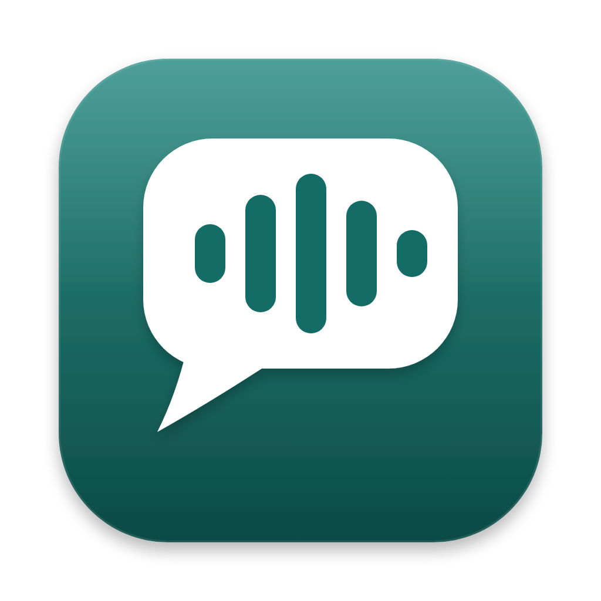
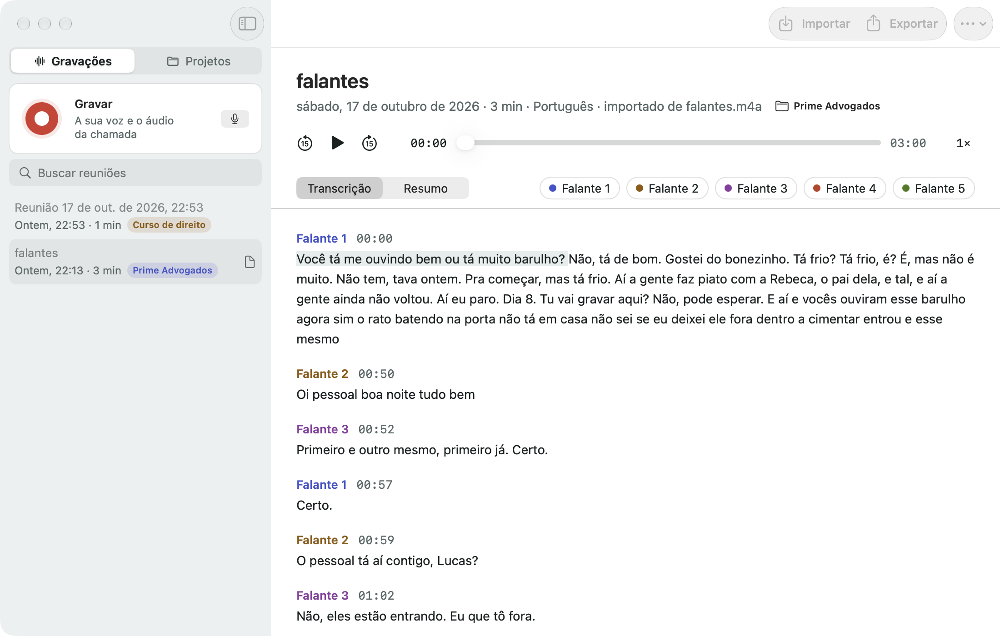
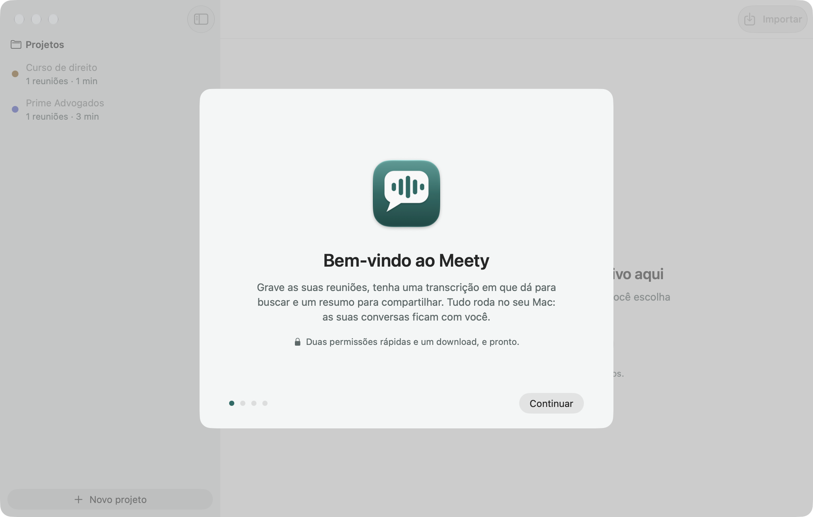
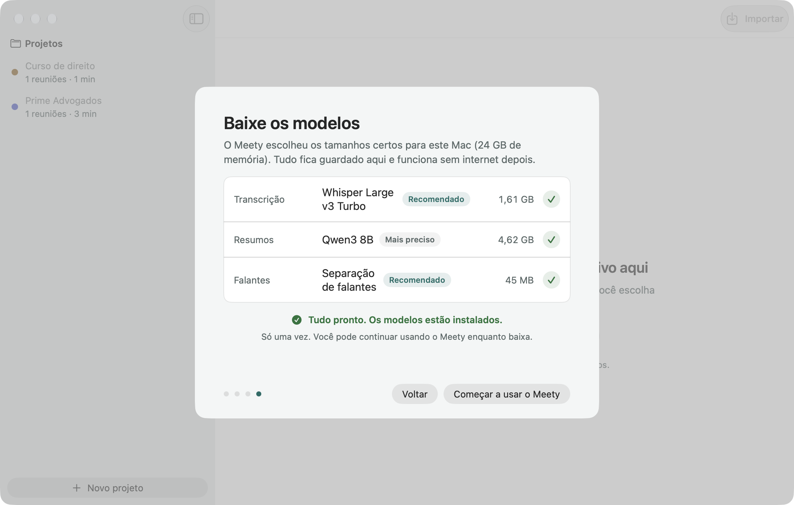
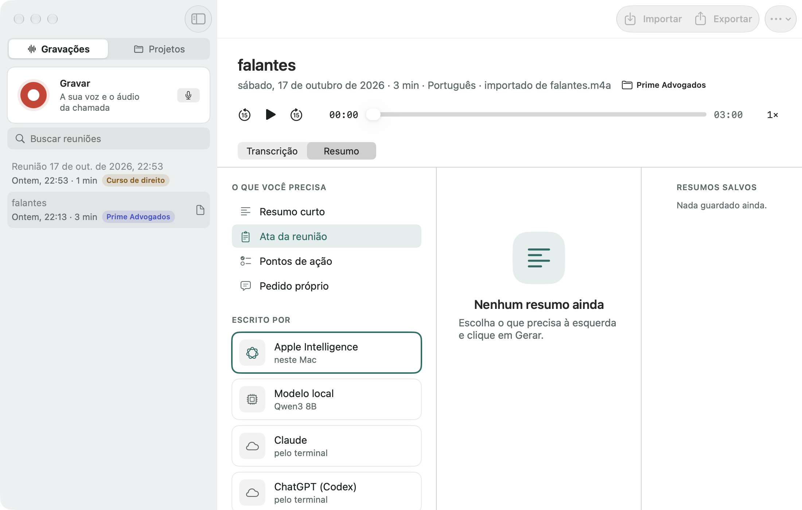

<h1 align="center">Meety</h1>

<b>Record, transcribe and summarize your meetings. Entirely on your Mac.</b>

  <a href="https://github.com/oka-projects/meety/releases/latest"><b>Download for Mac</b></a> ·
  macOS 15+ · Apple Silicon · Free and open source

English · <a href="#português">Português</a>

Meety turns any meeting into a searchable transcript and a clear summary. It records your calls
(Zoom, Meet, Teams, anything that plays on your Mac) together with your microphone, or transcribes
audio and video files you already have. Everything runs on your Mac's own chip: your conversations
never leave your computer unless you choose otherwise.

## What you can do

- **Record any call** with one click, from the window or the menu bar. Meety captures your voice and
  the other participants on separate tracks, so it always knows which lines are yours.
- **Tell participants apart.** The other voices are separated on the Neural Engine, and you can give
  each one a name.
- **Transcribe files** you drag in: voice memos, interviews, lectures, videos.
- **Read along.** Click any sentence to jump to that moment in the audio.
- **Get the summary**: a short recap, meeting minutes with decisions and next steps, an action list,
  or your own question about the meeting.
- **Search everything** you ever recorded.
- **File meetings into projects** (a client, a course, a team): switch the sidebar to Projects, drag
  recordings onto a project, and each recording shows its project tag.
- **Export** to text, Markdown, subtitles (SRT/VTT) or JSON, or copy with one click.
- **Private by design**: no account, no cloud, no tracking.

## Getting started

1. Download **Meety.dmg** from the [latest release](https://github.com/oka-projects/meety/releases/latest)
   and drag Meety to Applications.
2. Open Meety and follow the welcome steps. It asks for two permissions:
   - **Microphone**, to hear you.
   - **Screen & System Audio Recording**, to hear the other people in the call. Meety never records
     your screen; macOS just groups both under the same permission.
3. Click **Download recommended models**. Meety picks the right sizes for your Mac (about 2 to 7 GB,
   one time only).
4. Press **Record**, or drop a file in the window. That's it.

  
  

## Summaries: your choice of brain

| Option | Where it runs | What you need |
|---|---|---|
| Apple Intelligence | On your Mac | macOS 26 with Apple Intelligence turned on |
| Local model (MLX) | On your Mac | A one-time download inside Meety |
| Claude | Anthropic cloud | The Claude app or Claude Code, signed in |
| ChatGPT (Codex) | OpenAI cloud | The ChatGPT app or the Codex CLI, signed in |
| API key | Anthropic or OpenAI cloud | Your own key |

Cloud options are off until you pick them, and Meety asks before anything leaves your Mac.

## FAQ

- **Does it work with Zoom, Meet, Teams?** Yes. It records whatever your Mac plays, so it works with
  any app or browser tab. Remember to let the other participants know they are being recorded.
- **Which languages?** About 100, detected automatically. Portuguese and English get the best results.
- **How fast is it?** On an M-series Mac, one hour of audio usually takes a few minutes.
- **Where are my files?** Select a meeting and choose **Show in Finder**. Each meeting is a folder
  with the audio, the transcript and the summaries.
- **Does it update itself?** Yes. Meety checks for new versions once a day and updates in place.
- **Can I use it offline?** Yes, after the models are downloaded.

## Português

O Meety transforma qualquer reunião numa transcrição com busca e num resumo claro. Ele grava as suas
chamadas (Zoom, Meet, Teams, o que estiver tocando no Mac) junto com o seu microfone, ou transcreve
arquivos de áudio e vídeo que você já tem. Tudo roda no chip do seu Mac: as suas conversas nunca saem
do computador, a não ser que você escolha isso.

**O que dá para fazer**

- Gravar qualquer chamada com um clique, pela janela ou pela barra de menus. A sua voz e a dos outros
  participantes ficam em trilhas separadas, então o Meety sempre sabe quais falas são suas.
- Separar os participantes entre si (no Neural Engine) e dar um nome a cada um.
- Transcrever arquivos arrastados para a janela: memos de voz, entrevistas, aulas, vídeos.
- Clicar numa frase para ouvir aquele momento.
- Gerar um resumo curto, uma ata com decisões e próximos passos, uma lista de tarefas, ou perguntar o
  que quiser sobre a reunião.
- Buscar em tudo que você já gravou.
- Organizar as reuniões em projetos (um cliente, um curso, uma equipe): troque a barra lateral para
  Projetos, arraste as gravações para dentro, e cada gravação mostra a etiqueta do projeto.
- Exportar em texto, Markdown, legendas (SRT/VTT) ou JSON.
- Sem conta, sem nuvem, sem rastreamento.

**Como começar**

1. Baixe o **Meety.dmg** na [última versão](https://github.com/oka-projects/meety/releases/latest) e
   arraste o Meety para Aplicativos.
2. Abra o Meety e siga as boas-vindas. Ele pede duas permissões: **Microfone** (para ouvir você) e
   **Gravação de Tela e Áudio do Sistema** (para ouvir as outras pessoas da chamada; o Meety não grava a
   tela, o macOS só agrupa as duas coisas na mesma permissão).
3. Clique em **Baixar os recomendados**. O Meety escolhe os tamanhos certos para o seu Mac (de 2 a 7 GB,
   uma vez só).
4. Clique em **Gravar**, ou solte um arquivo na janela.

**Resumos**: Apple Intelligence (macOS 26), modelo local, Claude ou ChatGPT (usando os apps ou os CLIs
que você já tem no Mac, com a sua conta) ou uma chave de API própria. As opções na nuvem ficam
desligadas até você escolher, e o Meety avisa antes de enviar qualquer coisa.

**Perguntas frequentes**: funciona com qualquer app de chamada, porque grava o que o Mac toca (avise os
participantes). Cerca de 100 idiomas, detectados sozinhos; português e inglês têm os melhores resultados.
Uma hora de áudio leva poucos minutos num Mac com chip M. Os arquivos ficam numa pasta por reunião
(**Mostrar no Finder**). O app se atualiza sozinho.

---

## Technical details

- **Stack**: Swift 6 and SwiftUI, ScreenCaptureKit (system audio and microphone, macOS 15+),
  AVFoundation for decoding and mixing, [Sparkle 2](https://sparkle-project.org) for updates.
- **Speech engine**: an embedded Python 3.12 ([python-build-standalone](https://github.com/astral-sh/python-build-standalone))
  with [mlx-whisper](https://github.com/ml-explore/mlx-examples/tree/main/whisper) and
  [mlx-lm](https://github.com/ml-explore/mlx-lm) running on the GPU through Apple MLX. The app talks to it
  over a JSON Lines protocol on stdout (`engine/meety_engine.py`). No Homebrew, no ffmpeg, no venv:
  audio is decoded by AVFoundation and handed over as 16 kHz PCM.
- **Models** are downloaded from Hugging Face into `~/Library/Application Support/Meety/Models` and used
  offline after that. The catalog is [`models.json`](MeetyKit/Sources/MeetyCore/Resources/models.json):

  | Model | Size | Use |
  |---|---|---|
  | whisper-large-v3-turbo (MLX) | 1.6 GB | default transcription |
  | whisper-large-v3 (MLX) | 3.1 GB | best accuracy |
  | whisper-small (MLX) | 0.5 GB | small or 8 GB Macs |
  | Qwen3 4B Instruct 4-bit (MLX) | 2.3 GB | local summaries (8 to 16 GB Macs) |
  | Qwen3 8B 4-bit (MLX) | 4.6 GB | local summaries (24 GB or more) |
  | speaker-diarization-coreml | 45 MB | telling speakers apart |

- **Speakers**: recordings keep the microphone and the system audio as separate tracks. Each sentence
  is attributed by comparing the energy of the two tracks, so your lines are always "You". The system
  track alone goes through [FluidAudio](https://github.com/FluidInference/FluidAudio) (Core ML, Neural
  Engine) to separate the other participants. Imported files are diarized as a whole.
- **Claude and Codex**: Meety looks for the command line tools installed from the terminal and the ones
  shipped inside the Claude and ChatGPT Mac apps, tries them in that order, and runs them headless
  (`claude -p --tools ""`, `codex exec --sandbox read-only --ephemeral`) in a temporary folder with the
  transcript on stdin. If none works, "Send to app" copies the prompt and opens the app.
- **Data layout**: one folder per meeting in `~/Library/Application Support/Meety/Library/` with
  `audio.m4a` (mixed), `mic.m4a` and `system.m4a` (recordings only), `transcript.json`, `meta.json`
  and `summary-*.md`. Projects live in `Library/projects.json`; each meeting's `meta.json` carries its
  `projectID`. No database.
- **Privacy**: no analytics. The network is used only for model downloads, update checks and the
  cloud summary options you explicitly enable.
- **Design**: the identity, the palette (light and dark, eight speaker colors) and every screen were
  made in Claude Design; the tokens are in [`docs/design/tokens.json`](docs/design/tokens.json) and
  applied in `MeetyKit/Sources/MeetyUI/Theme.swift`. The boards are in `docs/design/boards/`.
- **Building from source**: `brew install xcodegen`, copy `Config/Local.xcconfig.example` to
  `Config/Local.xcconfig` with your team, then `scripts/build-mac.sh` (builds the engine the first
  time, then the app). Tests: `cd MeetyKit && swift test`. Release: `scripts/release.sh 1.0.0`.
- **Requirements**: Apple Silicon (M1 or later), macOS 15 Sequoia or later, about 8 GB of free disk
  for the app and the recommended models.
- **License**: MIT. Models keep their own licenses (Whisper: MIT; Qwen: Apache 2.0; check each model card).
